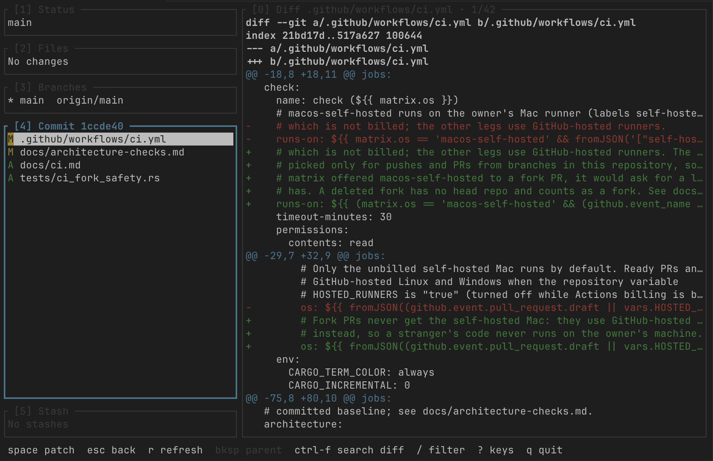
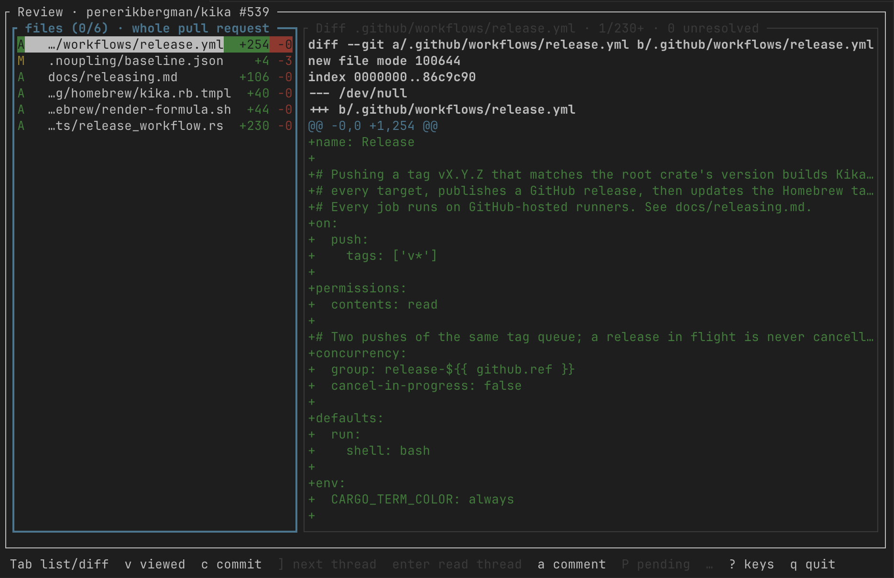

# Kika

[](https://github.com/pererikbergman/kika/actions/workflows/ci.yml)
[](https://github.com/pererikbergman/kika/releases/latest)
[](#license)

A terminal Git client and pull request review tool, built in Rust. Kika shows the
working tree, branches, commits, stashes and diffs of a repository in one fast,
keyboard-driven screen. It also lets you read and review GitHub pull requests and
GitLab merge requests without leaving the terminal.





## Features

- **Workspace:** the Status, Files, Branches, Commits and Stash panels, and the
  diff of what is selected.
- **Staging:** stage or unstage whole files, single hunks or single lines.
- **History rewrites:** squash, fixup, drop, reword, move, edit and break, and
  autosquash of `fixup!` commits.
- **Undo and redo** (`ctrl-z` / `ctrl-r`) of commits, checkouts, resets and rebases.
- **Conflicts:** resolve them in Kika or in your merge tool. Bisect from the
  Status panel.
- **Worktrees, submodules** and a **command log** of the git commands Kika ran.
- **Custom commands** (`[[commands]]`) bound to your own keys.
- **Themes** (`[theme]`), and no colour at all when `NO_COLOR` is set.
- **Mouse:** click to select and focus, scroll with the wheel (`[display] mouse`).
- **Review mode** for GitHub and GitLab: the queues, a request's files and diff,
  review threads, comments, the pending review and submit, merge, and checkout.

## Install

### Homebrew (macOS and Linux)

```sh
brew install pererikbergman/tap/kika
```

### Windows

1. Download `kika-<version>-x86_64-pc-windows-msvc.zip` and its `.sha256` file
   from the [releases page](https://github.com/pererikbergman/kika/releases).
2. Check the download. In PowerShell, run
   `Get-FileHash -Algorithm SHA256 kika-<version>-x86_64-pc-windows-msvc.zip`
   and compare the hash with the one in the `.sha256` file. Where `sha256sum`
   is available, `sha256sum -c kika-<version>-x86_64-pc-windows-msvc.zip.sha256`
   does the same.
3. Unpack the zip and put `kika.exe` in a folder on your `PATH`.

### Other targets

Each release has a `.tar.gz` (with a `.sha256` file) for each of its other
targets, listed in [docs/releasing.md](docs/releasing.md). Download the one for
your machine and put `kika` on your `PATH`.

### From source

With Rust 1.85 or newer:

```sh
cargo install --locked --path .
```

### Requirements

- git 2.15 or newer on `PATH`. Kika runs the `git` CLI. A few actions need a
  newer git; [docs/configuration.md](docs/configuration.md) says which.
- For review mode: [`gh`](https://cli.github.com) for GitHub, or
  [`glab`](https://gitlab.com/gitlab-org/cli) for GitLab.

## Quick start

Run `kika` inside a Git repository. These keys get you going:

| Key | Does | Binding |
|---|---|---|
| `1` | Focus the Status panel | `workspace.focus_status` |
| `2` | Focus the Files panel | `workspace.focus_files` |
| `3` | Focus the Branches panel | `workspace.focus_branches` |
| `4` | Focus the Commits panel | `workspace.focus_commits` |
| `5` | Focus the Stash panel | `workspace.focus_stash` |
| `?` | Show the keys for this panel | `global.help` |
| `space` | Stage the selected file, or unstage it if fully staged | `files.stage` |
| `enter` | Work on the hunks of the selected file | `files.hunks` |
| `c` | Commit the staged changes with a message | `files.commit` |
| `P` | Push the current branch | `workspace.push` |
| `p` | Pull into the current branch | `workspace.pull` |
| `ctrl-z` | Undo the last commit, checkout, reset or rebase | `workspace.undo` |
| `G` | Review this repository's pull or merge requests | `workspace.review` |
| `q` | Quit Kika | `global.quit` |

Every key can be changed. The full list is the
[binding reference](docs/configuration.md#binding-reference).

## Review mode setup

Kika does not use the network until you opt in. Name the hosts it may ask in the
`[forge]` table of the global config file: `github` for GitHub hosts, or `gitlab`
plus `gitlab_ask` for GitLab hosts.

```toml
[forge]
github = ["github.com"]
gitlab = ["gitlab.com"]
gitlab_ask = ["gitlab.com"]
```

Then log in with `gh auth login` or `glab auth login`. Press `G` in the
workspace to open the review queues, or run `kika review <number>` to start on
one GitHub pull request.

Changes to `[forge]` take effect after a restart. See
[`[forge]`](docs/configuration.md#forge-global-file-only) for every option.

## Configuration

Neither config file is required.

| File | Where |
|---|---|
| Global | `$XDG_CONFIG_HOME/kika/config.toml`, else `~/.config/kika/config.toml` (Linux, macOS); `%APPDATA%\kika\config.toml` (Windows) |
| Repository | `.kika.toml` at the top level of the repository, for `[keys]` only |

A small global file:

```toml
[keys]
"files.discard" = []   # turn off a binding

[forge]
github = ["github.com"]

[theme]
name = "light"
```

Every setting is described in [docs/configuration.md](docs/configuration.md).

## Privacy and safety

- No network unless you opt in: Kika only asks the forge hosts you list under
  `[forge]`, and only fetches in the background when you set `[watch] fetch`.
  Auto-fetch is off by default.
- Destructive actions, such as discarding work, a hard reset or dropping
  commits, ask first. Only `y` answers them, not Enter.

## Docs

- [Configuration](docs/configuration.md): settings, keys and the binding reference
- [Releasing](docs/releasing.md): how releases are built and installed
- [CI](docs/ci.md): how pull requests are checked
- [Manual regression](docs/manual-regression.md): the hands-on test pass
- [Architecture checks](docs/architecture-checks.md): the dependency audit
- [Technical spec](docs/tech-spec.md): the design
- [Architecture decisions](docs/adr/)

## Contributing

A pull request must pass:

```sh
cargo test --workspace
cargo clippy --workspace --all-targets -- -D warnings
cargo fmt --all --check
```

CI runs these. [docs/ci.md](docs/ci.md) says how pull requests, fork pull
requests included, are checked.

The rules that matter most:

- Kika follows MVI: `update` is pure and returns effects, and git, network and
  file work runs outside it.
- Views only read state.
- Git is reached through the `git` CLI, with argv only, never shell strings.

## License

Licensed under either of

- Apache License, Version 2.0 ([LICENSE-APACHE](LICENSE-APACHE))
- MIT license ([LICENSE-MIT](LICENSE-MIT))

at your option.

Unless you explicitly state otherwise, any contribution intentionally submitted
for inclusion in the work by you, as defined in the Apache-2.0 license, shall be
dual licensed as above, without any additional terms or conditions.
